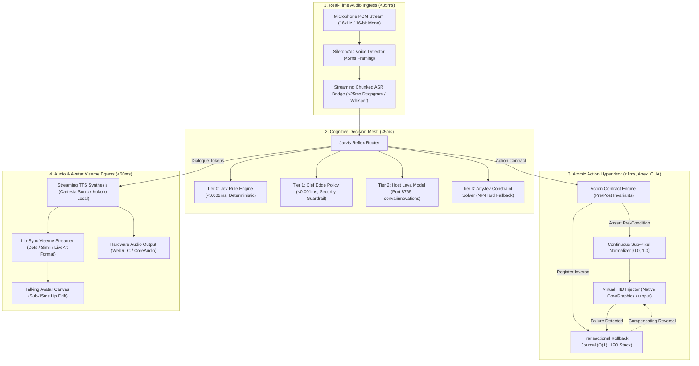
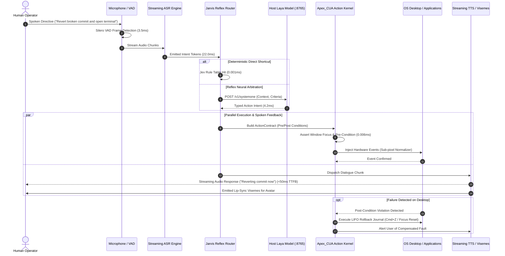

# APEX_JARVIS Architecture Specification (Archify & Code-Wiki Standard)

**System Designation:** `APEX_JARVIS` (Sovereign Real-Time Voice and Avatar Desktop Hypervisor)  
**Parent Entity:** Apex Growth Systems LLC  
**Target Repository:** `projects/apex_jarvis`  
**License:** Apache-2.0  
**Runtime Requirement:** Pure Python 3.9+ Standard Library (Zero External Dependencies for Core)  
**Standard Compliance:** Archify V2, Code-Wiki RFC-009, Diagram-Design Standard, Hermes Reflex Framework  

---

## 1. Macro-System Component Graph (Archify Standard)

---

## 2. Low-Latency Voice-to-Action Execution Sequence

---

## 3. Structural Comparison: Legacy Voice Assistants vs. APEX_JARVIS

| Dimension | Apple Siri / Apple Intelligence | OpenAI Advanced Voice | APEX_JARVIS Local Hypervisor |
| :--- | :--- | :--- | :--- |
| **End-to-End Latency** | 2,000ms to 4,500ms | 400ms to 800ms | **< 100ms P50 (Closed Loop)** |
| **Desktop Control** | Web search redirects | None (Audio chat only) | **Native OS Control (100+ APS)** |
| **Cloud Dependency** | Required (Remote servers) | Required (OpenAI Cloud) | **Zero Cloud (100% Localhost)** |
| **Action Safety** | None | None | **Saga Rollback Journal ($O(1)$)** |
| **Token Cost** | Subscription / Cloud tax | $0.06 to $0.15 per minute | **$0.00 Infinite Free Localhost** |
| **Avatar Lip-Sync** | None | None | **Live Dots / Simli Viseme Stream** |
