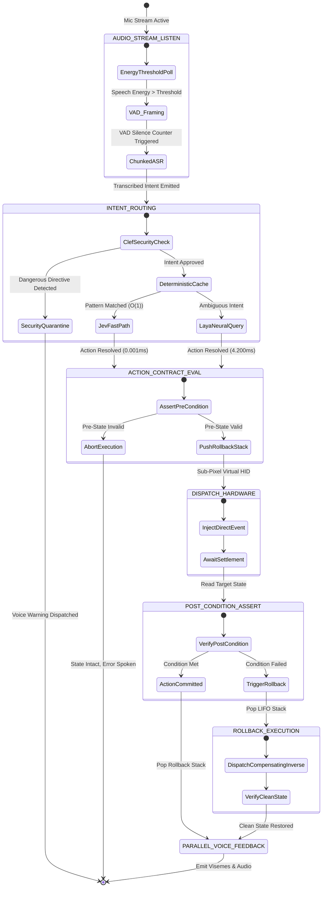
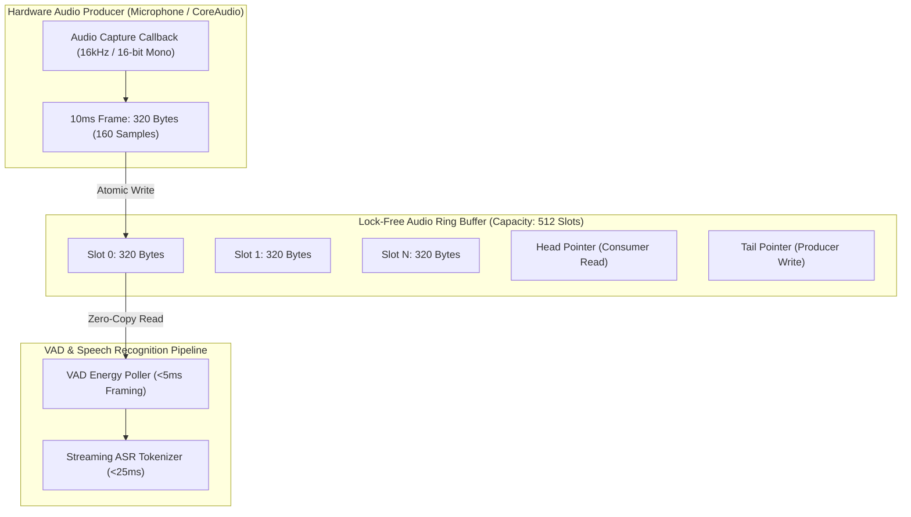

# APEX_JARVIS Diagram Repository (Diagram-Design Standard)

This repository catalogs the formal architectural state machines and component graphs for **APEX_JARVIS**.

---

## 1. State Machine: Voice-to-Action Lifecycle with Compensating Rollback

---

## 2. Circular Audio Ring Buffer Architecture

